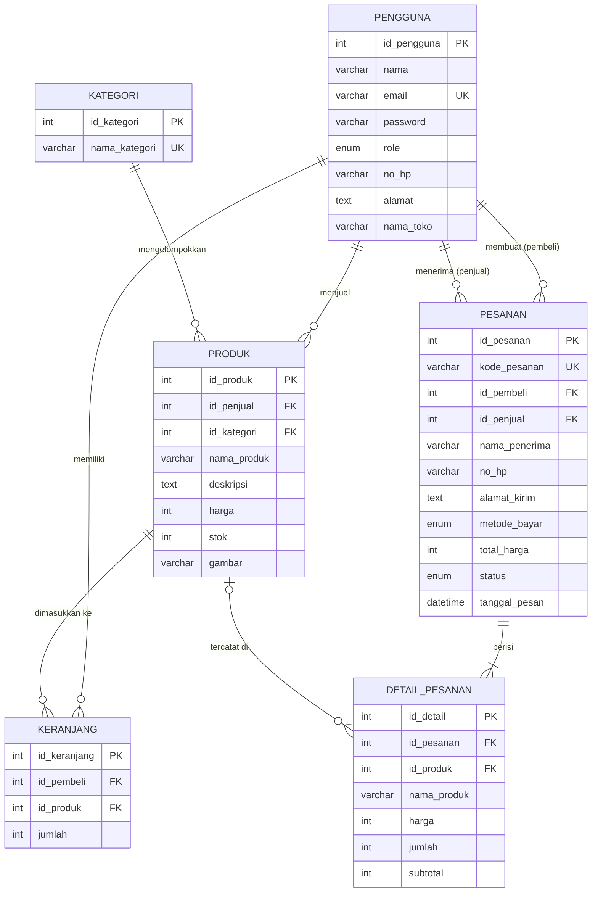

# LapakKita: Aplikasi Web Marketplace Sederhana

Aplikasi marketplace tempat **penjual** menawarkan produk dan **pembeli** memesan produk secara online.
Dibangun dengan **PHP Native**, **MySQLi** (prepared statement), dan **Bootstrap 5**.

- Demo online: `https://NAMA-SUBDOMAIN.infinityfreeapp.com` *(ganti dengan URL Anda)*
- Repository: `https://github.com/USERNAME/marketplace` *(ganti dengan URL Anda)*

## Fitur

| Fitur | File |
| --- | --- |
| Daftar produk + pencarian + filter kategori | `index.php` |
| Detail produk | `produk.php` |
| Kelola produk / CRUD (khusus penjual) | `penjual_produk.php` (Read), `produk_form.php` (Create & Update), `produk_hapus.php` (Delete) |
| Keranjang belanja (tambah, ubah jumlah, hapus) | `keranjang.php`, `keranjang_aksi.php` |
| Checkout dan simpan transaksi pesanan (otomatis dipecah satu pesanan per toko) | `checkout.php` |
| Riwayat dan detail pesanan pembeli | `pesanan.php`, `pesanan_detail.php` |
| Pesanan masuk + ubah status pesanan (khusus penjual) | `penjual_pesanan.php`, `pesanan_status.php` |
| Registrasi, login, logout | `register.php`, `login.php`, `logout.php` |

Keamanan yang diterapkan: prepared statement di semua query, `password_hash()` untuk password,
token CSRF di semua form POST, `htmlspecialchars()` untuk semua output, validasi tipe file gambar,
dan transaksi database (`begin_transaction` / `commit` / `rollback`) saat checkout.

## Akun demo

| Peran | Email | Password |
| --- | --- | --- |
| Pembeli | `pembeli@demo.com` | `pembeli123` |
| Penjual (Toko Sinar Jaya) | `penjual@demo.com` | `penjual123` |
| Penjual (Dapur Bu Sari) | `penjual2@demo.com` | `penjual123` |

## Struktur folder

```
marketplace/
├── assets/css/style.css      # Tema tambahan di atas Bootstrap
├── database/marketplace.sql  # Skema tabel + data contoh
├── includes/
│   ├── koneksi.php           # Koneksi MySQLi (membaca config.php)
│   ├── fungsi.php            # Fungsi bantu: escape, rupiah, CSRF, login
│   ├── header.php            # Navbar + pesan flash
│   └── footer.php
├── uploads/                  # Gambar produk yang diunggah penjual
├── config.example.php        # Contoh konfigurasi (salin menjadi config.php)
├── index.php, produk.php, keranjang.php, checkout.php, ...
└── README.md
```

## ERD



## Pesanan per toko dan status pesanan

Satu pesanan selalu milik satu toko. Jika keranjang berisi produk dari dua toko, checkout membuat
dua pesanan dengan kode INV berbeda, dan masing-masing penjual hanya melihat pesanan tokonya.

Penjual mengubah status dari halaman **Pesanan masuk**:

```
menunggu  ──▶  diproses  ──▶  dikirim  ──▶  selesai
    │              │
    └──────┬───────┘
           ▼
      dibatalkan  (stok produk dikembalikan otomatis)
```

Status tidak bisa melompat (misalnya langsung dari menunggu ke selesai), dan pesanan yang sudah
selesai atau dibatalkan tidak bisa diubah lagi. Pembeli melihat status terbaru di **Pesanan saya**.

## Memperbarui database dari versi pertama

Jika database Anda dibuat dari `marketplace.sql` versi pertama (sebelum ada fitur status per toko):

- **Data boleh hilang:** impor ulang `database/marketplace.sql`.
- **Data ingin dipertahankan:** jalankan `database/migrasi_pesanan_per_toko.sql` sekali di tab SQL phpMyAdmin.

## Menjalankan di komputer (XAMPP / Laragon)

1. Salin folder `marketplace` ke `htdocs` (XAMPP) atau `www` (Laragon).
2. Buka phpMyAdmin, buat database bernama `marketplace` (collation `utf8mb4_unicode_ci`).
3. Pilih database tersebut, buka tab **Import**, lalu impor `database/marketplace.sql`.
4. Salin `config.example.php` menjadi `config.php`, lalu sesuaikan isinya.
5. Buka `http://localhost/marketplace`.

Kebutuhan: PHP 7.4 atau lebih baru dengan ekstensi `mysqli`, serta MySQL 5.7+ atau MariaDB 10.3+.

## Deployment ke InfinityFree

1. Daftar di [infinityfree.com](https://infinityfree.com), lalu buat akun hosting dengan subdomain gratis.
2. Buka **Control Panel → MySQL Databases**, buat database (misalnya `marketplace`).
   Catat **MySQL Hostname**, **Database Name**, **Username**, dan **Password** yang ditampilkan.
   Hostname-nya bukan `localhost`, melainkan seperti `sqlXXX.infinityfree.com`.
3. Klik **Admin** (phpMyAdmin) di samping database tersebut, buka tab **Import**, lalu impor `database/marketplace.sql`.
4. Buka **File Manager** (atau FTP dengan FileZilla), masuk ke folder `htdocs`, hapus file bawaan,
   lalu unggah seluruh isi folder proyek (bukan foldernya).
5. Di dalam `htdocs`, buat file `config.php` berisi kredensial dari langkah 2:

   ```php
   <?php
   define('DB_HOST', 'sqlXXX.infinityfree.com');
   define('DB_USER', 'if0_XXXXXXXX');
   define('DB_PASS', 'password_hosting_anda');
   define('DB_NAME', 'if0_XXXXXXXX_marketplace');
   define('APP_NAME', 'LapakKita');
   ```

6. Buka URL subdomain Anda. Subdomain baru kadang butuh beberapa menit sampai beberapa jam sebelum bisa diakses.

## Mengunggah ke GitHub

```bash
cd marketplace
git init
git add .
git status            # pastikan config.php TIDAK ada di daftar
git commit -m "Aplikasi Web Marketplace dengan PHP Native, MySQLi, dan Bootstrap"
git branch -M main
git remote add origin https://github.com/USERNAME/marketplace.git
git push -u origin main
```

`config.php` dan isi folder `uploads/` sudah tercantum di `.gitignore`, sehingga password database
tidak ikut terunggah. Jangan pernah menulis password hosting langsung di file lain yang di-commit.
